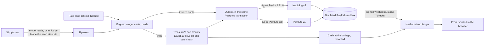

# Fair Split: audited co-op payroll on PayPal

**Every peso, traced to the pencil mark.**

**TODO (merger): the hosted Judge Mode URL (`/judge` on the Render host) goes here once it is deployed.**

**Judge it in 60 seconds:** no login, no PayPal account, no key. Open `/judge` and press **Play it for me**; you sign
the two keys. [The eight steps](#judge-it-in-60-seconds) ·
[What's real](#whats-real-replayed-simulated-and-synthetic) · [Run it locally](#run-it-locally-on-windows)

Fair Split is payroll for a farmers' co-op whose pay starts on handwritten weigh-slips. It protects the people
being paid: every member can see, line by line, why her number is her number, whether she is paid through PayPal
or in cash, and the buyer that funded the season can re-check every line in its own browser. The model reads
paper; code computes; people approve; PayPal executes (in this build, our PayPal simulator).

> **PayPal runs on a simulator, and the people are synthetic.** Every PayPal call in this repo goes to our own
> contract-faithful simulator of PayPal's REST APIs, labelled "Simulated PayPal sandbox" wherever a PayPal value
> appears ([ADR-0002](docs/adr/0002-simulated-paypal-sandbox-and-private-repo.md),
> [ADR-0010](docs/adr/0010-in-process-paypal-simulator.md)). The developer, in India, reports being unable to create
> the US PayPal accounts the plan assumed, so there are no sandbox REST credentials and the simulator stands in
> (ADR-0002). The client code is PayPal's own Agent Toolkit 1.11.0 plus our typed Payouts tool, but it is untested
> against PayPal's own sandbox. The co-op, its members, the buyer, the slips and the voices are synthetic; no real
> farmer was paid and no real money moves.

**TODO (merger): add the "What a farmer sees" GIF here (S3: at most 8 MB, 15 fps, English captions).**

The demo season: Bulawanon Kakaw Growers MPC (Calinan, Davao City; 64 members) ships cacao lot LB-PH-2026-03 to
Lantern Bay Chocolate Co., which pays one invoice of US$4,333.50 (premium US$2,887.50, quality bonus US$1,386.00,
disbursement costs US$60.00). PayPal **Invoicing v2 through Agent Toolkit 1.11.0** bills Lantern Bay and
**Payouts v1** pays the 7 of 64 members who have PayPal, both on a simulated PayPal sandbox; 57 are paid in cash on
the same statement. **Webhooks** from the simulator are verified, deduplicated and stored, and status checks confirm
each payout. **claude-opus-5-5** is built to read the slips twice, **claude-sonnet-5-5** to match deductions to the
co-op's ratified rules, and **claude-haiku-5-5** to screen slip text for injected instructions. A deterministic
engine, not the model, computes every amount in integer cents and holds anything it cannot justify; the treasurer
and the Chair approve with two keys.

_Claude writes in pencil. People sign in ink. PayPal makes it carbon._

## Judge it in 60 seconds

No login, no PayPal account and no key. Use a window at least 1024 px wide (the console on the left, the member's
phone beside it). "Play it for me" drives every step except the two keys; to run it on your own machine, see
[Run it locally on Windows](#run-it-locally-on-windows).
1. Open `/judge`, then press **Mark Lantern Bay's invoice paid (simulated PayPal sandbox)**. On the simulator the
   invoice is created and sent through Agent Toolkit 1.11.0, its AUTO_CANCEL rule is set, the payment is
   recorded, and a fresh GET reads it paid, so the run is funded.
2. Watch 12 photos read: a replay of a labelled seed stand-in, not a Claude recording. Under the photos,
   **Ten hero slips: the recorded exhibit** shows R1's real model output for the 10 hero slips (read A, read B and
   zoom for each field) beside the stand-in. Slip 0462 has a stained digit: type it, or press
   **Use logbook line 7**.
3. Resolve three holds. H1: slip 0457 is in two photos, the white original and the pink copy; **Count it once**
   returns US$17.94 to 63 members. H2: Merlyn Ponce's 300.0 kg from 140 registered trees is 2.14 kg a tree,
   over the limit of 1.6. H3: a ₱200 fine (multa) on slip 0458 matches no rule, so it comes back as a US$3.20
   credit.
4. Hold to sign **Approve 8 payouts**: key 1, an Ed25519 demo key made in your browser.
5. Co-sign as Ernesto, the Chair: in the Chair frame beside the console, or on your own phone with the single-use
   link and six-digit code the stage shows. Any batch over US$300 needs the Chair.
6. Watch the simulated PayPal sandbox accept the batch (sent, not yet paid), then confirm each item. When Rhea's
   item parks UNCLAIMED, press **Pay in cash at the bodega**.
7. Open Proof and press **Verify in your browser**: the hash chain, its signed checkpoint and Proof's six plates
   are checked on your device. Your run was signed with demo keys, so Proof reads Sample, never Verified. Tap a
   peso on the member's phone.
8. Press **Reset** for a fresh run in about 10 seconds.

Try to break it from the stage bar's **What's real** sheet: overcharge the invoice draft (the policy lattice
refuses it before any PayPal call); offset two invoice amounts or add an invoice recipient (refused); or
**Arm a payout change before key 2**. After both keys, one payout then moves by one cent just before the POST; the
Payouts tool re-hashes the batch from the database, sends nothing and voids both approvals.

Payout runs are limited per hour. If the hour's quota of payout runs is spent, the payout steps replay
an earlier simulated run, and every screen labels them as a replay.

## The problem

A cacao co-op's season of pay starts on paper. A clerk writes a weigh-slip for every delivery; months later one
buyer pays one premium for the whole lot, and the treasurer splits it across dozens of members by hand. Most
members cannot check their share, and the buyer cannot show that the premium reached them.
- Fairtrade's cocoa standard already asks producer organisations in Côte d'Ivoire and Ghana to give each member a
  receipt for the premium paid (requirement 4.3.4) and to record those payments digitally (4.3.5).
- In the Philippines, half of adults owned a formal financial account in 2025 (BSP, Consumer Finance and Inclusion
  Survey), so a co-op there pays many members in cash. Fair Split puts members paid in cash and members paid
  through PayPal on the same statement.
- There is no pilot partner yet.

## What a farmer sees

Nang Celing (member M-014, synthetic) opens her statement on the Fair Split app in Cebuano. Her line reads premium
US$43.69, quality bonus US$21.85, CBU (capital build-up) US$1.09 deducted, net US$64.45 (about ₱4,028, an estimate
at the run's fixed ₱62.50 per US$). Each amount can be tapped to show the slips behind it; her premium starts with
slip 0403 (38.45 kg). She can listen instead of read: sentences with a verified Gemini TTS clip play that clip, and
the rest are spoken by the phone's own voice, labelled. The statement says how the slips were read and that a
person checked the unsure ones. On seeded runs it says the readings are a labelled stand-in for Claude's double
reading.

Rhea Jumawan (M-031) has no PayPal account. Her payout item parks UNCLAIMED in the simulated PayPal sandbox, the
treasurer cancels it and pays her in cash at the bodega, and her line moves to the cash rail on the same statement.
Merlyn Ponce (M-053) is paid in cash too; her 80 mm print gives her line in exact pesos.

Statements are hand-written templates in English, Cebuano and Filipino, not model output. The Cebuano and Filipino
text is machine-translated, pending native review, and says so on screen.

## PayPal integration, built against the simulator

**Why PayPal.** The buyer is in the US and the members are in the Philippines. One PayPal invoice lets the buyer
fund the season in US dollars, and code reads its status back before anything is paid. One Payouts batch reaches
the members who have PayPal by e-mail; an item for a member without a PayPal account parks UNCLAIMED, and the
treasurer cancels it and pays her in cash on the same statement. Status checks and signed webhooks confirm each
item, and the outcome goes into the hash-chained ledger that Proof checks. In this build all of it runs on the
simulated PayPal sandbox.

Every call below runs against the simulated PayPal sandbox, which is contract-tested against PayPal's OpenAPI
specs. All of it is untested against PayPal's own sandbox.

| API           | How                                                                                                                                                                                             | Where                                                                 |
| ------------- | ----------------------------------------------------------------------------------------------------------------------------------------------------------------------------------------------- | --------------------------------------------------------------------- |
| Invoicing v2  | Through `@paypal/agent-toolkit` 1.11.0: `create_invoice`, `send_invoice`, `create_conditional_rules_for_invoice` (AUTO_CANCEL), `record_payment_for_invoice`, `get_invoice`, `search_invoicing` | `packages/paypal-toolkit`, `apps/api/src/money/`                      |
| Payouts v1    | Our typed tool with PR #107's names (`create_payout_batch`, `get_payout_batch`, `get_payout_item`, `cancel_unclaimed_payout_item`); the toolkit has no Payouts tool                             | `packages/paypal-payouts`                                             |
| Webhooks v1   | Simulator-signed notices, self-verified (CRC32 of the raw body plus RSA-SHA256), deduplicated by transmission id, stored with their delivery evidence                                           | `packages/paypal-core/src/webhook`, `apps/api/src/paypal/webhooks.ts` |
| The simulator | OAuth, Invoicing v2, Payouts v1, Webhooks v1, Transaction Search and balances; every request and response validated against PayPal's published specs                                            | `packages/paypal-sim`, `apps/api/src/paypal/simulator.ts`             |

How each call is guarded:
- **Invoice.** Code computes the quote; the create, rule and send bodies are the domain's canonical forms, and the
  policy lattice compares the whole body with the quote (unknown keys such as tips or extra recipients are named
  and refused). The send needs the treasurer's approval, bound to that exact invoice. The run is FUNDED only when a
  fresh GET reads PAID or MARKED_AS_PAID with nothing due; in Judge Mode "Mark paid" is the simulator's
  record-payment, labelled as simulated.
- **Payouts.** `PayoutsService.executeApproved` re-reads the locked lines and approvals from the database,
  recomputes the batch digest and the lines digest, and checks both signatures against the registered officer
  keys before it posts. `sender_batch_id` is `{season}-{rc8}-r{runSeq}` and `PayPal-Request-Id` is its sha256, so
  a retry cannot pay twice; on "already exists" it adopts the batch only if every item re-hashes to the approved
  digest. An UNCLAIMED item is cancelled (RETURNED) before the member is paid in cash.
- **Webhooks.** The certificate URL's shape is checked before any fetch, certificate fetches are capped per hour,
  and a delivery older than 5 minutes is refused. In simulator mode the simulator's own CA stands in for PayPal's
  certificate and is trusted only in that mode. A verified, stored `PAYMENT.PAYOUTS-ITEM.SUCCEEDED` applies at
  once ([ADR-0013](docs/adr/0013-stored-webhook-delivery.md)); every other status waits for a fresh GET, and a
  status only moves forward. Signed webhooks and status checks move each payout; in this build both come from the
  simulated PayPal sandbox.
- **Limits.** One shared limiter allows 40 PayPal requests a minute across the service, below PayPal's documented
  sandbox throttle, which the simulator models; a 429 opens a 6-minute circuit. The Payouts tool also enforces a
  per-batch ceiling, a receiver allowlist, a daily cap on posted (non-replayed) payout batches and a balance floor,
  and a kill switch is read before every POST.
- **Switching rails.** `PP_MODE=simulator` is the default. It was designed so one variable points it at PayPal's
  sandbox (`PP_MODE=sandbox` with a REST app's credentials); this has not been tested.

## AI system

| The model does                                                                                                         | Code does                                                                                    |
| ---------------------------------------------------------------------------------------------------------------------- | -------------------------------------------------------------------------------------------- |
| Turns each slip photo into fields with a box per field, twice (reads A and B), and re-reads a doubtful field on a crop | Scores agreement, auto-accepts at 0.85 or above, and sends the rest to a person              |
| Flags slip text that reads like an instruction                                                                         | Quarantines it; slip text re-enters a prompt only as JSON data                               |
| Names the ratified rule a deduction matches, or NO_MATCH                                                               | Computes every amount in integer cents and holds what the rules cannot justify               |
| Quotes the rate card's rules from its pages                                                                            | Checks every quote against the text layer; the board ratifies the card and its hash is fixed |

Nothing the model writes becomes a number in a line, invoice, payout or statement (invariant I1).

| Job                  | Model             | Effort | Guard                                                                                           | Ran live                                 |
| -------------------- | ----------------- | ------ | ----------------------------------------------------------------------------------------------- | ---------------------------------------- |
| Slip reads A and B   | claude-opus-5-5   | low    | `Extraction` schema: a box per field, no amount or instruction fields; agreement scored in code | In R1 (10 hero slips) and in development |
| Zoom re-read         | claude-opus-5-5   | medium | One field on a sanitised crop                                                                   | In R1                                    |
| Injection screen     | claude-haiku-5-5  | low    | A refusal counts as suspected; the slip's text is quarantined, never followed                   | In R1                                    |
| Rate-card reader     | claude-opus-5-5   | medium | Every quote must match the verified text layer; the board ratifies                              | Not on the judge path                    |
| Deduction classifier | claude-sonnet-5-5 | low    | A ratified rule ID or NO_MATCH; code checks every amount                                        | Not on the judge path                    |

What a judge sees, and the guards around every call:
- **Judge Mode replays a labelled seed stand-in for the slip reading.** The Render blueprint carries no Anthropic
  key; the readings a judge sees are the seed's, labelled "Seed stand-in, not a Claude recording". The console's
  reading room shows R1's real responses for the hero slips beside the stand-in.
- **Reading is scored in code**: both reads clear and equal score 0.97, an overwritten field always goes to a
  person, and auto-accept needs 0.85. Slip text re-enters a prompt only as JSON-encoded data.
- **`ClaudeGateway`** (`packages/ai/src/gateway`) is the only Anthropic SDK import in product code (two schema
  spikes aside). Its replay key is sha256 of `{imageSha, variant, promptV, schemaV, model, effort}`; a run in
  `replay_only` mode fails on a missing recording instead of calling out. It reads the `kill_ai_live` switch before
  every call, enforces per-lane spend caps and a daily cap across lanes, always sets effort, and sends any stop
  other than `end_turn` to a person.
- **The audit agent is paused** (WS-AGENT), so no model drafts the invoice. Statements are hand-written templates.

## Eval: R1, the only real Claude output

On 1 Nov 2026 (UTC) R1 ran the reading pipeline live, once, on the 10 synthetic hero slips, plus one unscored
four-slip photo: claude-opus-5-5 for reads A and B and the zoom, claude-haiku-5-5 for the injection screen, through
`ClaudeGateway`. Its 38 model responses (all of them, the four-slip photo included) are committed in
[`packages/eval/recordings`](packages/eval/recordings) and scored in
[`packages/eval/report/R1.md`](packages/eval/report/R1.md).

| Metric (N = 10 scored slips)    | Double read, screen and zoom | A-only baseline |
| ------------------------------- | ---------------------------- | --------------- |
| Exact rows                      | 10 of 10                     | 10 of 10        |
| Unsafe auto-accepts             | 0                            | 0               |
| Injection caught (one example)  | 1 of 1                       | not measured    |
| Duplicate pair found (one pair) | 1 of 1                       | not measured    |

What these numbers do not show:
- The labels are **provisional**: agent-checked, not reviewed by a person. N is small, there is no held-out set,
  and the single read scored the same as the double read, so no benefit from the second read is shown.
- R1's member registry was built from the 6 members on the labelled slips, not the seed's 64, so unsafe
  auto-accepts may be under-counted (R1.md).
- Slip 0462's stained gross and net were not auto-accepted: both were sent to a person, as designed.
- Not evaluated: an OCR-only baseline, the rate-card reader, the deduction classifier and payroll-level
  results. Judge Mode still replays the seed stand-in; these readings do not replace it.
- Reproduce offline, with no key and no live call:
  `corepack pnpm --filter @fairsplit/eval exec tsx src/r1.ts`.

## AI tools used to build it

| Tool                                                 | How it was used                                                                                                                                                 |
| ---------------------------------------------------- | --------------------------------------------------------------------------------------------------------------------------------------------------------------- |
| claude-opus-5-5, claude-sonnet-5-5, claude-haiku-5-5 | The runtime jobs in [AI system](#ai-system)                                                                                                                     |
| Claude Code                                          | Claude Code agents wrote, reviewed and merged the code under an automated review-and-verify protocol; the user approved every outward step                      |
| OpenAI Codex CLI                                     | Built some work packages from written briefs, under the same review                                                                                             |
| OpenAI's image model (gpt-image-2) via Codex CLI     | The 14 synthetic images in [Synthetic data](#synthetic-data-prompts-and-hashes)                                                                                 |
| Gemini 3.8 Flash TTS                                 | Member statement audio, labelled as a synthetic voice                                                                                                           |
| Gemini 3.8 Flash, 3.6 Flash and 2.5 Flash            | Speech recognition that checks each clip against its exact sentence before it is published (the model per clip is in `media/audio/statement-verification.json`) |

## Simulated run IDs

Every ID the simulator mints keeps PayPal's documented shape and carries the marker `SIM` inside it, so an ID
copied anywhere still says it came from the simulated PayPal sandbox
([`packages/paypal-sim/src/util/ids.ts`](packages/paypal-sim/src/util/ids.ts)). The marker is a label, not proof:
provenance comes from the rail.

| Object                | Shape                                          |
| --------------------- | ---------------------------------------------- |
| Invoice               | `INV2-SIMx-xxxx-xxxx-xxxx`                     |
| AUTO_CANCEL rule      | `CR-SIMx-…`                                    |
| Recorded payment      | `EXTR-SIM` and 14 characters                   |
| Payout batch and item | `SIM` and 10 characters                        |
| Webhook event         | `WH-SIM` and 14 characters, `-`, 17 characters |
| Error debug ID        | `sim-` and 12 hex characters                   |

## What's real, replayed, simulated and synthetic

| Kind      | What                                                                                                                                                                                                                                                                                                                                                                                                           |
| --------- | -------------------------------------------------------------------------------------------------------------------------------------------------------------------------------------------------------------------------------------------------------------------------------------------------------------------------------------------------------------------------------------------------------------- |
| Real      | Your presses, the holds you resolve and the approvals you sign (Ed25519, in your browser); every amount, computed by the engine in integer cents; the rate card's hash, fixed before the first slip; Proof's checks on your device; R1's committed Claude responses for the 10 hero slips ([eval](#eval-r1-the-only-real-claude-output)).                                                                      |
| Replayed  | The slip reading in Judge Mode: 48 slips in 12 photos use a labelled seed stand-in ("Seed stand-in, not a Claude recording"). The invoice's line labels are a placeholder written with the seed: the audit agent is paused, and no model drafted the invoice. Payout steps when the hour's quota is spent, labelled as a replay.                                                                               |
| Simulated | Every PayPal call, ID, status, webhook and fee: the simulated PayPal sandbox. Its IDs carry `SIM` ([Simulated run IDs](#simulated-run-ids)) and its debug IDs start with `sim-`. Also the phone's push banners, the biometric step (a demo key) and the clerk's scanner (sample slips).                                                                                                                        |
| Seeded    | The invoice-send approval, and the 54 earlier photos' manifest entries with their seeded read dates (those photos are not imaged).                                                                                                                                                                                                                                                                             |
| Synthetic | The co-op, its 64 members, its officers, Lantern Bay, 264 slips in 66 photos (only the 48 slips in photos A–L are imaged; the other 54 photos are manifest entries), the rate card, the logbook and every voice. The 10 hero slips were made by OpenAI's image model through Codex CLI; photos A–L are composed in code from them and code-drawn slips ([Synthetic data](#synthetic-data-prompts-and-hashes)). |
| Not built | A hosted demo (not deployed yet), the APK, push notifications, the clerk's offline capture, real SMS, iOS, the audit agent, and production partner onboarding (PayPal must grant third-party permissions for Invoicing and Payouts).                                                                                                                                                                           |

## Prior art

Re-scanned 4 Nov 2026, before the hackathon's Devpost gallery was public, so entries published since are not
covered. Most projects in the same neighbourhood protect the payer or the parties to a contract. Some now give the
person paid a receipt (Last Call, FairShift AI, MicroSplit AI), and two come close on approval and proof:
Neighborline has two passkey signers on one approval hash and rules ratified by signed hash, and SarafuPay shows a
signed proof checked in the visitor's own browser. None we found starts from a handwritten weigh-slip. Fair Split
reads each slip twice, holds what the ratified rate card cannot justify, binds the officers to one batch hash, puts
members paid in cash on the same statement as members paid through PayPal, and lets the buyer re-verify every line
in its own browser.

| Project                                                                                     | What it does                                                                                                                                                                                                | Where Fair Split differs                                                                                                                                                                                         |
| ------------------------------------------------------------------------------------------- | ----------------------------------------------------------------------------------------------------------------------------------------------------------------------------------------------------------- | ---------------------------------------------------------------------------------------------------------------------------------------------------------------------------------------------------------------- |
| [Neighborline](https://github.com/Aaaaarin/neighborline)                                    | Mutual-aid payouts: AI reads a voice note, code computes from the group's written rules, two organizers sign one approval hash on their phones, one Payouts batch; cash hand-overs under the same approvals | Closest on approvals. Fair Split starts from handwritten slips, has its rate card ratified by the board rather than by the approvers, gives each member a statement, and lets the buyer re-verify                |
| [Last Call](https://devpost.com/software/last-call-04cy1l)                                  | A photo of the shift board is read with Claude; code splits the tip pool; one manager approves one Payouts batch; each worker gets a line-by-line receipt link                                              | Closest on the payee's receipt. One approver, no ratified rule hash, and shares without PayPal wait for a later batch; Fair Split adds the Chair's co-sign, cash on the same statement and the buyer's own check |
| [Supplora Pay](https://devpost.com/software/supplora-pay)                                   | Claude reads a restaurant's supplier invoices; integer-cent checks against delivery notes hold bad lines; the owner approves one Payouts batch                                                              | Protects the payer; Fair Split pays the members and shows each one her line                                                                                                                                      |
| [Clause-to-Cash](https://devpost.com/software/clause-to-cash-contracts-that-collect)        | Contract terms extracted with citations; a 10-rule guard gates Invoicing v2 invoices and Payouts revenue shares                                                                                             | Starts from a contract; Fair Split starts from handwritten slips and a ratified, hashed rate card                                                                                                                |
| [Tributary](https://devpost.com/software/tributary-executable-revenue-share-infrastructure) | Plain-English revenue shares locked by a SHA-256 hash; integer-cent payouts with clawbacks; payee statements                                                                                                | Closest on hashed rules and money discipline; Fair Split adds slip reading, holds, the Chair's co-sign and cash members                                                                                          |
| [SarafuPay](https://devpost.com/software/sarafupay)                                         | A Tanzanian group-collection treasurer over WhatsApp, with signed, hash-chained proof checked in the browser                                                                                                | Also checks a signed proof in the browser; it collects for a group, with no handwritten source or ratified rules                                                                                                 |
| [TipPool](https://github.com/braileanuolimpiu-max/TipPool)                                  | House tip rules become exact-cent splits; one Payouts batch pays the staff                                                                                                                                  | Typed house rules; Fair Split reads paper and ratifies the rate card before the first slip                                                                                                                       |
| [PayFlow](https://devpost.com/software/payflow-gj19y4)                                      | Receipt photos parsed by AI and matched to the ledger in code; one approval releases a batch payout                                                                                                         | Reimburses spending; Fair Split splits a premium across members                                                                                                                                                  |
| [CoTreasury](https://devpost.com/software/cotreasury)                                       | An AI treasurer explains, members approve, and a hash-chained activity log records it                                                                                                                       | Governs a shared pot by vote; Fair Split computes each member's pay from paper and gives her a statement                                                                                                         |
| [555 Buku](https://github.com/bryanfrds/PayPal-Hackathon)                                   | An AI vision model reads photos of a shop's handwritten IOU notebook; the owner checks lines; Invoicing collects from debtors                                                                               | Also reads handwriting, but to collect debts; Fair Split pays members under ratified rules, with holds and the Chair's co-sign                                                                                   |
| [PAY PAP](https://devpost.com/software/pay-pap)                                             | Bulk payouts from an uploaded CSV: fixed rules flag duplicates and unusual amounts, one person decides each warning and a different person approves the exact total                                         | Closest on separation of duties; it starts from a CSV, with no ratified rate card, member statements or cash path                                                                                                |
| [FieldGrant](https://github.com/divyatejsingh-byte/fieldgrant)                              | Grant tranche releases: a vision model reads receipts and rosters twice, code compares the passes, checks hold duplicates and overspend, and a clean release sends a Payout                                 | Also reads twice and holds in code, but for the payer; it releases on its own when clean, with no two-signer approval, statements or cash path                                                                   |

Also checked: Solar Co-op, Routewell and harambee, which bill, collect or pay in neighbouring ways but do not read
a co-op's paper into audited lines.

## Known limitations

- PayPal runs only on the simulated PayPal sandbox. The integration is untested against PayPal's own sandbox, and
  production payouts to the Philippines are not shown.
- Fees on screen are simulator-reported: $0.25 × 8 = $2.00 for the batch, PayPal's published US rate. In production
  a Philippine co-op pays PayPal PH's fees: receiving the invoice at 4.40% + US$0.30, payouts 2% capped at ₱50
  each, conversion 3.0%. The payout fees fit inside the US$60.00 disbursement line.
- The slip reading in Judge Mode is a labelled seed stand-in. The only real model output is R1's, on 10 slips,
  against provisional labels.
- The people and data are synthetic. Peso figures convert at the run's fixed ₱62.50 per US$: exact pesos on a cash
  member's print, an estimate for a member paid through PayPal.
- Cebuano and Filipino text is machine-translated, pending native review. Voices are Gemini TTS, labelled as
  synthetic; a sentence without a verified clip uses the device voice, labelled.
- The simulator's state is in memory: a restart forgets its objects and ends every open judge session. fs-api runs
  as one instance in simulator mode.
- Not built yet: the rows under "Not built" in [What's real](#whats-real-replayed-simulated-and-synthetic).

## Run it locally on Windows

Prerequisites: Windows 10 or 11, Git, and Node 24 LTS (24.19.0 or a later 24.x; CI pins 24.19.0), which ships
corepack. On Node 25 or newer, corepack is not bundled: run `npm install -g corepack` first. pnpm 11.28.6 comes
through corepack. Nothing else: Postgres is embedded, and PayPal is the in-process simulator.

```powershell
git config --global core.longpaths true
git clone https://github.com/GODOSTROYER/fair-split.git
cd fair-split
$env:COREPACK_ENABLE_DOWNLOAD_PROMPT = "0"
corepack pnpm install --frozen-lockfile
corepack pnpm --filter @fairsplit/e2e stack     # builds the console and /app, starts Postgres and fs-api
```

The last command prints `ready: http://127.0.0.1:<port>/judge`; open that URL. Ctrl-C stops fs-api and the
database. It needs no `.env`: with no keys set, fs-api uses throwaway signing keys and the seed's labelled
stand-in for the reading.

Other commands, from the repository root:

```powershell
corepack pnpm typecheck
corepack pnpm test                               # every package; Postgres tests use embedded Postgres
corepack pnpm --filter @fairsplit/api smoke      # boot fs-api and smoke every route
corepack pnpm --filter @fairsplit/e2e exec playwright install chromium   # once: Playwright 1.64.1's Chromium
corepack pnpm e2e                                # the Playwright suite
```

On Linux or macOS, run the same commands in a POSIX shell, with `export COREPACK_ENABLE_DOWNLOAD_PROMPT=0` in place
of the `$env:` line (the `core.longpaths` line matters only on Windows). CI runs them on Linux; macOS is untested.
Two Linux specifics, from the clean-clone check on Ubuntu 24.04 ([DR-4](docs/reports/cloud-dr4-linux.md)):
- Run as a regular user, not root. Postgres refuses to run as root, so the embedded database cannot start in a root
  shell, such as a Docker container. As root, give the tests and the stack a Postgres server's admin URL instead:
  `export FS_TEST_DATABASE_URL=postgres://postgres@127.0.0.1:5432/postgres`. `corepack pnpm verify` removes `FS_*`
  variables from its children, so pass it the same URL as `corepack pnpm verify --db=<url>`.
- A fresh Linux install lacks the system libraries Chromium needs. Install them with the browser, once:
  `corepack pnpm --filter @fairsplit/e2e exec playwright install --with-deps chromium` (it asks for sudo for the
  system packages).

The keyless stack is the local path we support. fs-api does not read `.env` by itself: `.env.example` lists the
variable names a deployment sets (on Render, per-service environment variables). Never commit `.env`.

**TODO (merger): the Android APK link and its SHA-256 go here, only if an APK ships.**

## Verify it yourself

```sh
corepack pnpm verify                 # clone the committed tree, then install, typecheck, lint, deps:check, test, build
corepack pnpm verify-proof <url>     # re-check a Proof page: https, or http on localhost
```

`pnpm verify` (`tools/verify.ts`) clones the committed tree, never the working copy, and runs install, typecheck,
lint, the dependency rules, every package's unit and integration tests (not the Playwright suite or the booted
smoke) and the build, each with every API key, PayPal and database credential and kill flag removed from the
environment, so it proves the repo passes on recorded fixtures alone. The Postgres tier runs on embedded Postgres.

`pnpm verify-proof <url>` (`tools/verify-proof.ts`) takes a public Proof URL (`https://<host>/proof/<runSlug>`),
fetches the bundle and the published keys with no cookie or credential, and runs the same verify-core as the
browser: the hash chain, its signed checkpoint and the six plates. It prints each plate's result and the rail's
provenance, and exits 0 only when the record is accepted.

## Postman

[`postman/`](postman/README.md) holds a Postman v2.1 collection with tests: the judge's 60-second loop, Proof verify
and the labelled failure paths. It runs against a **local keyless stack only** (the simulated PayPal sandbox and the
seed's labelled stand-in reading), never against a hosted demo. Start the stack in one terminal and run the collection
from the repository root in another; newman 6.2.3 comes through `npx`, so nothing is installed.

```powershell
$env:COREPACK_ENABLE_DOWNLOAD_PROMPT = "0"
corepack pnpm --filter @fairsplit/e2e stack              # prints "fs-api up at http://127.0.0.1:<port>"
node postman/run.mjs --base-url http://127.0.0.1:<port>  # in a second terminal
```

On Linux or macOS, use `export COREPACK_ENABLE_DOWNLOAD_PROMPT=0` in place of the `$env:` line. The runner refuses
any origin that is not loopback http and any fs-api whose rail is not `simulated`. It prints the request, assertion
and failure counts, and keeps newman's JSON report under `.codex-scratch/postman/`.

## Tests

Counts from the merge trial of main at 8fc978c (1 Nov 2026). The console's count is from its own run: under the
trial's load some of its files timed out, and they pass when rerun alone.

| Package               | Tests | Package                   | Tests |
| --------------------- | ----: | ------------------------- | ----: |
| `apps/api`            | 1,034 | `packages/paypal-core`    |   515 |
| `apps/mobile`         |   898 | `packages/paypal-toolkit` |   275 |
| `apps/console`        |   783 | `packages/paypal-payouts` |   261 |
| `apps/tasks`          |   349 | `packages/db`             |   246 |
| `media`               |   377 | `packages/domain`         |   235 |
| `packages/test-kit`   |   347 | `packages/ai`             |   233 |
| `packages/paypal-sim` |   178 | `packages/tokens`         |   139 |
| `packages/motion`     |   110 | `packages/ui-web`         |    93 |
| `packages/api-client` |    80 | `packages/outbox`         |    44 |
| `packages/seed`       |    44 | `packages/contracts`      |    43 |
| `packages/seal`       |    28 | `packages/i18n`           |    28 |
| `packages/eval`       |    22 |                           |       |

On the same commit the booted smoke (fs-api on embedded Postgres and the in-process simulator, every route and
every IC-01 command) passed 85 of 85 checks. The Playwright suite (`corepack pnpm e2e`) ran 33 tests in 8 spec
files: 31 passed and 1 is skipped. The 60-second "Play it for me" budget failed only while the laptop was throttled
below base clock; an A/B run of the same commit minutes later measured 53.6 s from the first press to the payout
POST.

## Architecture

A TypeScript monorepo (pnpm 11.28.6 through corepack, Turborepo, Node 24). One Node service, fs-api, serves
everything from one origin, with Postgres behind it.



| Path                                                  | What it is                                                                                                                                         |
| ----------------------------------------------------- | -------------------------------------------------------------------------------------------------------------------------------------------------- |
| `apps/api`                                            | fs-api: Hono `/v1` routes generated with their OpenAPI 3.1 document, server-sent events, `/webhooks/paypal`, the outbox dispatcher, static serving |
| `apps/console`                                        | The treasurer's console and the Judge stage, Proof and `/ops` (Vite, React, TanStack Router, AG Grid Community)                                    |
| `apps/mobile`                                         | The Fair Split app (Expo SDK 58): member statement, Chair co-sign, clerk capture; its web export runs at `/app` and in the stage's phone frames    |
| `apps/tasks`                                          | The task registry and its executors (`inline` for local runs and CI), and the tests of the repo tools in `tools/`                                  |
| `packages/contracts`                                  | IC-01: zod 4 DTOs, routes, the `RunEvent` union, task names, error codes, labels                                                                   |
| `packages/domain`                                     | IC-02, pure: money in integer cents, the engine, holds, state machines, the policy lattice, digests, Proof's verify-core                           |
| `packages/seed`                                       | IC-03: the season snapshot, the single source of every demo figure (`canonical.test.ts` checks them to the cent)                                   |
| `packages/db`                                         | IC-04: Drizzle schema and migrations, scoped repositories, the event log, the hash-chained ledger, the shared PayPal limiter                       |
| `packages/outbox`                                     | The transactional outbox: enqueue in the caller's transaction, dispatch, executors                                                                 |
| `packages/paypal-core`                                | IC-05: OAuth, the one HTTP door to PayPal, offline webhook verification, payout-item status rules (zod 3)                                          |
| `packages/paypal-toolkit`                             | The only importer of `@paypal/agent-toolkit` 1.11.0: allowlist, schemas, the invoice chain                                                         |
| `packages/paypal-payouts`                             | Our typed Payouts v1 tool in the Agent Toolkit tool shape, and `PayoutsService`, the only caller of the money-moving endpoints                     |
| `packages/paypal-sim`                                 | The PayPal simulator (simulated rail, ADR-0002), run in fs-api's process (ADR-0010)                                                                |
| `packages/ai`                                         | `ClaudeGateway`, slip extraction, the rate-card reader, the deduction classifier                                                                   |
| `packages/eval`                                       | The labelled extraction eval and R1's report                                                                                                       |
| `packages/api-client`                                 | The typed HTTP and SSE client derived from the command table, plus msw handlers backed by the seed                                                 |
| `packages/test-kit`                                   | Shared test helpers and E-19, the lint that checks public copy and every money or kilo figure against IC-03                                        |
| `packages/{tokens,motion,seal,i18n,ui-web,ui-native}` | Design tokens, motion presets, the batch seal, the en/ceb/fil catalogs and the web and native primitives                                           |
| `media`, `e2e`, `video`                               | Synthetic media and its tooling, the Playwright harness, the film script                                                                           |

The dependency rule, enforced by dependency-cruiser (`corepack pnpm deps:check`):

```text
contracts ← domain ← {seed, db} ← outbox ← {paypal-*, ai} ← {apps/api, apps/tasks}
UI code (console, mobile, ui-*) imports only contracts, api-client, tokens, motion, seal, i18n, ui-*
```

**Invariants I1–I8** (architecture §0): the model never writes a number into a line, invoice, payout or
statement; rules are frozen before facts; money is conserved; the approved digest is the payout; state only moves
forward; a person approves the irreversible step; effects go through the transactional outbox; nothing simulated
is unlabelled. Invariant tests are named `inv.iN.*`.
- **The outbox.** A state change and the effect it asks for (a PayPal call, a statement, an SSE notice) are
  written in one Postgres transaction, under a dedupe key; the dispatcher runs the effect afterwards, inline in
  fs-api. A task that fails or stops is retried with backoff, and every handler is idempotent.
- **The ledger.** Every event is appended to a hash-chained ledger; the application role cannot UPDATE or DELETE
  it. Checkpoints are signed with Ed25519. Proof's six plates (invoice, rate card, slips, lines and cash, two keys,
  payout items) are checked against the chain and the published keys, in the browser or with
  `pnpm verify-proof`.
- **Interface contracts.** IC-01 to IC-12 (DTOs, domain, seed, persistence, PayPal core, money, AI, HTTP, design
  system, moments, media, frame bridge) are frozen and change only by ADR ([`docs/adr/`](docs/adr/)).

## AG Grid

The treasurer's split review is an AG Grid Community 36.2.0 grid
(`apps/console/src/features/split/SplitAgGrid.tsx`):
- themed from our design tokens through `@fairsplit/tokens/ag-grid` (Quartz with our two colour modes, Tablea dark
  and Adlaw light, picked by `data-ag-theme-mode`);
- eleven custom cell renderers (`cells.tsx`): member, slips, kilos with a kilos-per-tree bar, confidence rings,
  premium, bonus, deductions with rule chips, credit, net, rail (with a hatched cash cell) and status;
- a change wash that is jade only when a PayPal status changed (a verified item notice) and pencil only when the
  engine recomputed a line, and never for replayed history;
- only the modules the screen uses, registered once, in a lazily loaded chunk with a 300 KB budget.

## Synthetic data: prompts and hashes

Every image is synthetic and carries a printed specimen line. The fourteen images below were made by OpenAI's
image model (gpt-image-2) through Codex CLI, one prompt per image; each prompt is committed byte for byte. Hashes
are SHA-256, first 12 hex characters; the full values, every attempt and the review notes are in
[`media/manifest.json`](media/manifest.json).

| Image              | Kind            | Prompt                                                                               | Prompt hash    | Master hash    |
| ------------------ | --------------- | ------------------------------------------------------------------------------------ | -------------- | -------------- |
| `br-2026-04-p1`    | rate card page  | [`br-2026-04-p1.4e0803bb.md`](media/prompts/history/br-2026-04-p1.4e0803bb.md)       | `4e0803bbcfcf` | `e2d156ab17d6` |
| `br-2026-04-p2`    | rate card page  | [`br-2026-04-p2.85989510.md`](media/prompts/history/br-2026-04-p2.85989510.md)       | `85989510b1f6` | `23880a2e13f0` |
| `logbook-p14`      | logbook page    | [`logbook-p14.0ef8efbb.md`](media/prompts/history/logbook-p14.0ef8efbb.md)           | `0ef8efbbcad1` | `1f118aba8a71` |
| `spike-0403`       | slip            | [`spike-0403.1e8df52d.md`](media/prompts/history/spike-0403.1e8df52d.md)             | `1e8df52d756c` | `1f5c0ef7ff17` |
| `spike-0419`       | slip            | [`spike-0419.9a4f9c08.md`](media/prompts/history/spike-0419.9a4f9c08.md)             | `9a4f9c08dfe3` | `013e50059bb4` |
| `spike-0436`       | slip            | [`spike-0436.2d501eb3.md`](media/prompts/history/spike-0436.2d501eb3.md)             | `2d501eb37c9d` | `df55951e1198` |
| `spike-0449`       | slip            | [`spike-0449.512625e5.md`](media/prompts/history/spike-0449.512625e5.md)             | `512625e5af07` | `e6e3066b766c` |
| `spike-0457-pink`  | slip            | [`spike-0457-pink.1bd549ab.md`](media/prompts/history/spike-0457-pink.1bd549ab.md)   | `1bd549ab0b93` | `a66c7af0101b` |
| `spike-0457-white` | slip            | [`spike-0457-white.a4e0c647.md`](media/prompts/history/spike-0457-white.a4e0c647.md) | `a4e0c6471e7d` | `4ddac00fa1c2` |
| `spike-0458`       | slip            | [`spike-0458.91648819.md`](media/prompts/history/spike-0458.91648819.md)             | `9164881996de` | `cb9ef34e97af` |
| `spike-0462`       | slip            | [`spike-0462.3e4fe705.md`](media/prompts/history/spike-0462.3e4fe705.md)             | `3e4fe705cf47` | `f62f63f1a2c9` |
| `spike-0467`       | slip            | [`spike-0467.90526272.md`](media/prompts/history/spike-0467.90526272.md)             | `90526272db76` | `e1968ab5dd66` |
| `spike-0471`       | slip            | [`spike-0471.532f3698.md`](media/prompts/history/spike-0471.532f3698.md)             | `532f36988f73` | `703b94e9c8d7` |
| `spike-4up`        | four-slip photo | [`spike-4up.d96de074.md`](media/prompts/history/spike-4up.d96de074.md)               | `d96de0742d88` | `be31ef48a8f6` |

The rest of the synthetic material:
- **Photos A–L** are composed in code (`corepack pnpm --filter @fairsplit/media exec tsx src/compose/cli.ts`)
  from eight of the hero slips and 40 code-drawn slips, with no model and no network. Each placement's transform
  and source hashes are in the manifest's `compositions`, and the twelve WebP hashes are in
  [`packages/seed/src/photo-hashes.json`](packages/seed/src/photo-hashes.json), which Proof's slips plate checks.
- **Labels.** Every hero slip was checked field by field by an agent; a person has not reviewed the labels yet,
  which is why R1's results are provisional.
- **Voices.** Member audio is Gemini 3.8 Flash TTS. Each clip's text hash, audio hash and speech-recognition check
  (by Gemini 3.8 Flash, 3.6 Flash or 2.5 Flash, named per clip) are in
  [`media/audio/manifest.json`](media/audio/manifest.json) and
  [`media/audio/statement-verification.json`](media/audio/statement-verification.json).
- **The season** (members, slips, lines and every figure) is generated by `packages/seed` from a fixed seed.

## What's next

- Run the same code against PayPal's own sandbox (`PP_MODE=sandbox`); it is untested today.
- Person-reviewed labels and a larger, held-out set of slips for the eval.
- Native-speaker review of the Cebuano and Filipino text, which is machine-translated today.
- A pilot co-op: there is no pilot partner yet.
- The business model: the buyer pays a per-run audit fee. The co-op stays merchant of record, and Fair Split never
  holds funds.
- Production onboarding, where PayPal must grant third-party permissions for Invoicing and Payouts.

## Built during the hackathon

Fair Split is a new project: the first commit is 22 Oct 2026, inside the PayPal AI Hackathon window
(1 Oct–12 Nov 2026), and the work is in small commits from parallel workstreams; see the git history.

## Repository and licence

- Specs: [`docs/spec/`](docs/spec/); the [decision register](docs/spec/00-decision-register.md) wins every conflict.
  Decisions since: [`docs/adr/`](docs/adr/).
- Agent rules: [`AGENTS.md`](AGENTS.md). Ownership: [`docs/ownership.md`](docs/ownership.md). Pins:
  [`docs/versions.md`](docs/versions.md). Security: [`SECURITY.md`](SECURITY.md), [`docs/security.md`](docs/security.md).
- The Devpost text is generated: [`docs/devpost.md`](docs/devpost.md), from `tools/devpost-text.ts`.
- [Contributing](CONTRIBUTING.md) · [Code of Conduct](CODE_OF_CONDUCT.md)
- Licence: code under [MIT](LICENSE). Fonts under the SIL Open Font Licence
  ([`assets/fonts/licences`](assets/fonts/licences)); Material Symbols under Apache-2.0; the Payouts parameter
  schemas adapted from PayPal's agent-toolkit pull request 107 under Apache-2.0
  ([`packages/paypal-payouts/NOTICE`](packages/paypal-payouts/NOTICE)).
